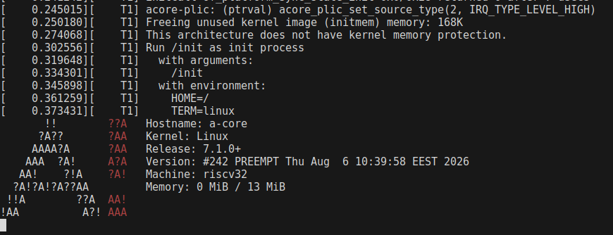

+++
date = '2026-06-15'
start_date = '2026-06-15'
end_date = '2026-08-31'
title = 'Aalto Research Assistant'
summary = 'Worked with booting Linux on A-Core in the Aalto Microelectronics Research unit METKA'
tags = ['RISC-V', 'C/C++', 'Python', 'IC Design', 'Linux']
showTags = true
+++

Worked with booting Linux on the Aalto University's [A-Core](https://gitlab.com/a-core) processor.

Linux booted in simulation in both **machine** (M,U) and **supervisor** (M,S,U) execution modes.

